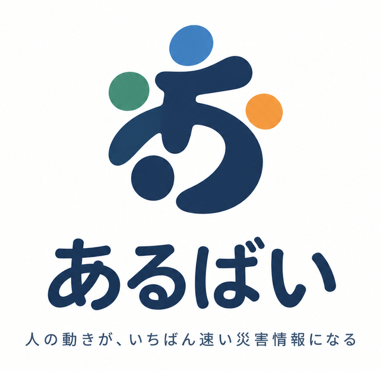
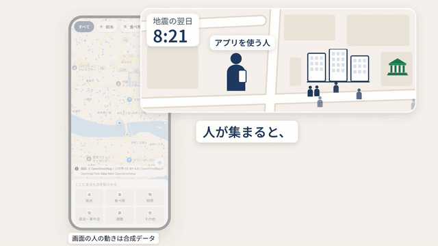

<p align="center"></p>

# あるばい

> 人の動きが、いちばん速い災害情報になる

**あるばい**（熊本弁で「あるよ」）は、災害時に利用者の匿名の位置情報から「いつもと違う人の集まり」を見つけ、公式の一覧に載らない支援拠点を地図に載せる仕組みです。
店や個人の炊き出し、物資の配布、ボランティアの給水、車中泊の集まりが対象です。
集まりの正体は、その場にいる利用者に「ここに何がある？」と聞いて確かめます。

<p align="center"><a href="https://youtu.be/xDCVE76HEzk"></a></p>
<p align="center">▶ <a href="https://youtu.be/xDCVE76HEzk">紹介動画（YouTube、3 分）</a>　／　<a href="https://built-with-claude-japan-2026-lapis.pages.dev/?demo=1&amp;from=08:00&amp;speed=5">デモを開く</a>（地震の翌日を合成データで早回し再生します。位置は取りません）</p>

- 動かすのに必要なものは Docker だけです（[5. 動かし方](#5-動かし方)）
- ライセンスは MIT です。地図と公開データは、それぞれの提供元の条件に従います

## 目次

1. [あるばいがすること](#1-あるばいがすること)
2. [背景](#2-背景)
3. [仕組み](#3-仕組み)
4. [検知の結果](#4-検知の結果)
5. [動かし方](#5-動かし方)
6. [プライバシーと安全](#6-プライバシーと安全)
7. [限界と今後](#7-限界と今後)
8. [文書](#8-文書)
9. [参考文献](#参考文献)
10. [ライセンス](#ライセンス)

## 1. あるばいがすること

災害のとき、公式の情報に出てこない支援があります。
店が店先で始めた炊き出しや、ボランティアの給水は自主的な活動なので、市役所やテレビからは知らされず、知る方法は SNS と近所の人だけになります。
あるばいは、配る人の発信を待たずに、人の動きからそうした場所を見つけます。

```
 ① 人の動き        ② 自動で検知           ③ 現地に聞く                 ④ 地図に表示
 匿名の位置  ───▶  いつもと違う    ───▶  その場の人に             ───▶  非公式の拠点
                   集まりを見つける       「ここに何がある？」             として共有
```

人の動きを使う理由は三つあります。

- 誰も投稿しなくてよい。配る人の発信を待ちません
- つながりがなくてよい。知り合いがいなくても見つかります
- 集まった時点でわかる。SNS で広まるのを待つより速く見つかります

使われ方の例です。

```
 9:00   ボランティアが公園で給水を始める（SNS への投稿なし）
 9:30〜 利用者が立ち寄る
10:30   自動で検知し、近くの利用者に「ここに何がある？」と聞く
10:35   「給水」と回答があり、地図に載る
```

| 立場 | 役に立つこと |
|---|---|
| 被災者 | つながりがなくても、近くの給水や炊き出しが見つかる |
| 配る人（店、ボランティア） | 投稿や拡散のお願いをしなくても見つけてもらえる |
| 自治体や支援団体 | 公式の外の拠点や車中泊の集まりを把握し、物資と人の配分に使える |

## 2. 背景

発案者は熊本県八代市の出身です。
2016 年の熊本地震と 2025 年 8 月の八代市の豪雨で自身が被災し、2026 年 7 月の熊本地震では実家と友人が被災しました。
一番欲しかった情報は「今、どこで水と食べ物がもらえるか」でした。
助けになったのは店が店先で配っていた食事や商品でしたが、その情報は SNS と近所の人からしか届かず、「知っていたら教えて」「拡散して」と人づてに頼むしかありませんでした。
自治体の職員も被災しながら避難所の運営と支援を続けており、善意の炊き出しが周知されずに空いていることもありました。

公開されている記録にも、公式の情報だけでは避難や支援の実態がつかめない様子が表れています。

| 事実 | 出典 |
|---|---|
| 2016 年熊本地震では、避難者の 68.3% が車中泊をした。指定避難所に最も長くいた人は 16.8% | [熊本県 県民アンケート調査 結果報告書](https://www.pref.kumamoto.jp/uploaded/attachment/50130.pdf) |
| 2026 年熊本地震では、避難指示 25.8 万人に対し、避難所にいた人は 8,698 人（7/29）。車中泊などは把握されていない | [熊本県 被害情報 第1報](https://www.pref.kumamoto.jp/uploaded/life/282503_903848_misc.pdf)、時事通信 2026/8/2 |
| 2026 年の熊本県全体で、公式の給水拠点 79 か所の情報は 8 つの自治体サイトに分散し、呼び方は 11 通りあった | [名古屋大学 応急給水拠点マップ（防災科研 bosaiXview）](https://www.bosai.go.jp/info/saigai/2026/20260729.html) |

課題は二つです。

1. **情報が一元化されていない**。公式は公式、非公式は SNS と近所の人
2. **つながりがないと届かない**。「教えて」「拡散して」と頼める相手が要る

## 3. 仕組み

```
スマホの画面 ── 位置を 30 秒に 1 点記録し、60 秒ごとにまとめて送る
   │
   ▼
サーバー ── 対象地域の外の点や時刻のおかしい点を捨てて保存する（14 日で消す）
   │  5 分ごと
   ▼
検知 ── その人の「いつもと違う滞在」を 500m のマスと 30 分の時間帯で数える
   │
   ▼
候補「？」── 候補から 500m 以内にいる利用者に「ここに何がある？」と聞く
   │  回答: 給水、食べ物、物資、車中泊、避難、その他、わからない、もう終わっていた
   ▼
確認済み ── 非公式の拠点として、公式の避難所や給水所と同じ地図に載せる
```

利用者が自分から「ここで配っている」と知らせることもできます。
その場合も候補として扱い、ほかの利用者の回答で確認済みになります。

### 検知の考え方

その人にとって「いつもと違う場所」に 10 分以上とどまった人を、同じ場所と同じ時間帯で数えます。
場所ごとに平常時の人数と比べる方式は、災害時には使えません。
街全体の動きが変わり、どの場所も一斉に「いつもより多い」になるからです。
そこで比べる相手を「場所の平常」から「その人の平常」に変えました。
一人ひとりについて直近 7 日から自宅といつもの場所を求め、そのどちらでもない場所への滞在だけを数えます。
数えた人数は、その日の街全体の「いつもと違う滞在」の量から求めた期待値と比べ、ポアソン分布で偶然とは言えないほど多いときに候補にします。
基準が街全体の量に合わせて動くので、災害の日に多くの人が出歩いても、どの場所も候補になるという事態にはなりません。

- 5 人未満の集まりは候補にしません（少人数の集まりを表示しないため）
- 自宅の周り 200m は数えません
- 開設中の公式の拠点から 150m 以内の集まりは候補にしません（公式のピンがすでにあるため）
- AI（大規模言語モデルや深層学習）は使っていません

数式と定数、採らなかった方式は [docs/algorithm.md](docs/algorithm.md) にあります。

### 候補が確認済みになるまで

検知された候補は、近くの利用者 1 人が種類を答えると確認済みになります。
利用者の報告から生まれた候補は、報告者を含めて 2 人の回答が要ります。
「もう終わっていた」という回答が「やっている」以上になると終了になります。
ピンは最後の確認から 3 時間で薄くなり、6 時間で地図から消えます。

## 4. 検知の結果

数字は 2 種類あり、混ぜないでください。

**実データでの検証**は、LINEヤフーの公開データ YJMob100K（日本のある都市、2.5 万人 × 75 日、うち 15 日が緊急期、500m と 30 分の単位）で行いました。

| 検証 | 結果 |
|---|---|
| 既存方式の限界 | 緊急期は街全体が一斉に「いつもより多い」になる（63 日目 6〜9 時: 多いマス 1847、少ないマス 2）。場所ごとの比較では区別できない |
| 誤報 | 新しい場所への滞在の割合が平日の約 24% から約 44%（約 1.8 倍）に増えても、誤報は増えない |
| 精度 | 実際の 1 日に場所と時刻を決めた集まりを埋め込み、1 日 3 件を人が確認する前提で、アプリ利用者 10 人の集まりを 97〜98% 検知した。検知までの時間は中央値 90 分 |

この検証のコードは、まだこのリポジトリに入っていません。

**合成データでの答え合わせ**は、このリポジトリの検知の実装を、八代市の合成データ（1000 人を市民の縮図とし、1 分刻み、平常 14 日と地震当日と翌 2 日）で確かめたものです。
合成データの行動は仮定が多く、実際の災害時の精度を意味しません。

- 測定用のデータ 3 本で、93 件の集まりをすべて検知し、誤報は 3 件（1 日 0.3 件）、検知までの時間は中央値 30 分
- 参加率（アプリを入れた人の割合）を変えると、見える集まりの大きさは「集まりの人数 × 参加率 ≥ 5」が目安。参加率 5% なら 100 人規模、20% なら 25 人規模から見え始める

詳しい表は [docs/algorithm.md](docs/algorithm.md) §4 にあります。

## 5. 動かし方

必要なものは Docker（Compose）だけです。

```sh
docker compose up -d --build --wait     # API と DB（PostgreSQL + PostGIS）を起動する
docker compose exec api pytest -q       # テスト（実際の DB を使う）
```

起動すると、そのマシンのポート 18080 で画面と API が動きます。
ブラウザで開くと同意の画面が出て、同意すると地図が表示されます。
API の仕様書は同じサーバーの `/docs` にあります。

参加できるのは対象地域（既定では八代市役所から 25km）の中にいる人だけです。
ほかの場所で試すときは、環境変数 `AREA` を変えるか空にします。

### 公開するときに決めること

- HTTPS で公開する。スマホのブラウザは HTTPS でないと位置を取れません。TLS を終端する前段（リバースプロキシなど）は、使う人の環境で用意します
- 対象地域を決める。`AREA` に災害地域の中心と半径を設定します
- DB のパスワードを変える。`DATABASE_URL` を差し替えます
- 前段の有無を伝える。前段を置かずに公開するときは `TRUST_PROXY` を空にします

### 環境変数

| 変数 | 既定 | 意味 |
|---|---|---|
| `DATABASE_URL` | `postgresql://app:app@db:5432/app` | DB の接続先 |
| `AREA` | `32.5072,130.6016,25000` | 対象地域を `緯度,経度,半径m` で指定する。中にいる人だけが参加でき、外の位置と報告は受け付けない。空にすると制限なし |
| `DETECT_EVERY_S` | `300` | 検知の間隔（秒）。`0` で止める |
| `RATE_LIMIT` | （有効） | `off` で書き込みの回数制限を止める（開発用） |
| `TRUST_PROXY` | `1` | `1` のとき、前段が付けた `X-Forwarded-For` の IP で参加の回数制限を数える。前段なしで公開するなら空にする |

例: `AREA=32.80,130.71,20000 docker compose up -d`

### 公式の拠点を取り込む

公式の避難所と給水所は、地図に公式のピンとして出ます。

```sh
docker compose exec api python scripts/import_bodik.py                                               # 八代市の避難所（BODIK 令和8年熊本地震オープンデータ）
docker compose exec api python scripts/import_official.py data/official/<file>.csv --source <名前>   # ほかの地域や給水所（CSV）
```

CSV の列は [data/official/README.md](data/official/README.md) にあります。
何度実行しても重複しません。

### 合成データで試す

実際の利用者がいなくても、八代市の合成データで検知から地図までを通して動かせます。
Python 3.12 と numpy が要ります。

```sh
python scripts/synth/make_demo_data.py --out data/out     # 1000 人 × 1 分 × 17 日の合成データを作る（約 3 分）
python scripts/synth/simulate.py --people 300 --days 8    # API 経由で投入する。地震の翌日を今日にずらす（約 3 分）
docker compose exec api python -m app.detect_job          # 今の時刻で検知する（5 分ごとにも自動で回る）
```

地図に「？」のピンが出ます。
そのピンの近くで画面を開くと「近くで人が集まっています」と聞かれ、答えると確認済みになります。
DB を空に戻すには `docker compose down -v` を実行します（取り込んだ公式の拠点も消えます）。

## 6. プライバシーと安全

利用者にとって:

- 名前も連絡先も受け取りません。位置は参加ごとの番号に結びつけて保存し、14 日で消します
- 地図に出るのは拠点のピンだけです。一人ひとりの位置や移動は表示しません
- 自宅の周り 200m は数えず、5 人未満の集まりは候補にしません
- メニューからいつでも参加をやめられ、送ったデータは消えます

運用する人にとって:

- 嘘の拠点を載せにくくしています。回答できるのは候補から 500m 以内にいる人だけで、1 人 1 候補 1 票です。備考に URL や電話番号は書けず、通報が 2 件あると表示しません
- 対象地域の外からは参加も報告もできません
- 参加、位置の送信、回答、報告、地図の読み込みに回数制限があります

守れていないこと（GPS の偽装、複数端末での多重参加など）と運用の注意は [docs/security.md](docs/security.md) にあります。

## 7. 限界と今後

限界:

- 実データ（YJMob100K）は 30 分と 500m の単位です。15〜45 分で終わる短い給水は未検証です
- 八代市の結果は合成データで、仮定に左右されます
- 災害時の実データでの精度は未測定です。災害時の位置情報と拠点の正解がそろったデータがありません
- 参加率 5〜10% では、数十人の小さな炊き出しは見えません
- 「いつもの場所」を判定するため、位置の点をサーバーに置いています（仮名化）。端末で判定して集計だけを送る形はまだです
- Web 画面は閉じると位置が取れません（特に iPhone）
- 集まりが 2 つのマスにまたがると、半分ずつに割れて見逃すことがあります

今後:

- 「ここに何がある？」と聞く場所チャンネルの試作と、実地での実験
- LINE ミニアプリやネイティブアプリ化（画面を閉じても位置が取れるように）
- 端末内で判定し、集計だけを送る形
- 実際の行動の記録が集まったら、合成データを作り直して確かめる

## 8. 文書

| 文書 | 内容 |
|---|---|
| [docs/architecture.md](docs/architecture.md) | システム構成と選定理由、API、DB の表、位置データの形式、候補の状態、ディレクトリ構成 |
| [docs/algorithm.md](docs/algorithm.md) | 検知アルゴリズムの考え方、手順、定数、合成データでの結果、採らなかった方式 |
| [docs/security.md](docs/security.md) | セキュリティと個人情報。入れている守り、守れていないこと、運用、確かめ方 |
| [docs/web-ui-design.md](docs/web-ui-design.md) | 画面の設計と、API と DB のルール |
| [docs/demo-data-design.md](docs/demo-data-design.md) | 合成の人流データの作り方、仮定値、2026 年熊本地震の事実 |
| [data/README.md](data/README.md) | 入力データの出典とライセンス |
| [CLAUDE.md](CLAUDE.md) | 企画の芯、検証の数字と出典、発表の構成 |

発表と審査用のデモ（画面での早回し再生）と紹介動画の素材は `demo` ブランチにあります。

## 参考文献

※「本文確認済み」と書いていない文献は、要旨のみ確認。

### 場所ごとの平常比較は災害時に崩れる

- **Jiang, R., Song, X., Huang, D., Song, X., Xia, T., Cai, Z., Wang, Z., Kim, K.-S., Shibasaki, R. (2019). DeepUrbanEvent: A System for Predicting Citywide Crowd Dynamics at Big Events.** Proceedings of the 25th ACM SIGKDD International Conference on Knowledge Discovery & Data Mining, 2114–2122. https://doi.org/10.1145/3292500.3330654
  - 地震・台風・大きな祭りなどの「大きな出来事」のときは、人の動きが日常と大きく変わるため、街全体の人の動きの予測が難しいと指摘
  - 直近1時間の街全体の人の動きを入力にして、次の1時間を予測するシステムを提案。動画の予測と同じ考え方で、深層学習（再帰型ニューラルネットワーク）を使う
  - 企画との関係: 「災害時は平常時の比較が通用しない」ことを支持

- **Fan, Z., Song, X., Shibasaki, R., Adachi, R. (2015). CityMomentum: An Online Approach for Crowd Behavior Prediction at a Citywide Level.** Proceedings of the 2015 ACM International Joint Conference on Pervasive and Ubiquitous Computing (UbiComp 2015), 559–569. https://doi.org/10.1145/2750858.2804277
  - 過去のデータを使わず、直近の人の動きだけで街全体の短期の人の動きを予測する方法（似た動きの人をまとめて予測する）
  - 大規模災害への対応を目的とした研究の一部
  - 企画との関係: 「災害時は過去の平常データに頼れない」ことを支持

### 個人の移動は規則的で、逸脱が信号になる

- **Song, C., Qu, Z., Blumm, N., Barabási, A.-L. (2010). Limits of Predictability in Human Mobility.** Science, 327, 1018–1021. https://doi.org/10.1126/science.1177170
  - 匿名の携帯電話利用者5万人（1,000万人から無作為に抽出）の3か月分の移動を分析
  - 移動の予測可能性は利用者全体で93%。移動距離が人によって大きく違っても、予測可能性はあまり変わらない
  - 企画との関係: 人の動きは規則的なので、「いつもと違う場所に行った」こと自体が信号になる

- **Song, C., Koren, T., Wang, P., Barabási, A.-L. (2010). Modelling the scaling properties of human mobility.** Nature Physics, 6, 818–823. https://doi.org/10.1038/nphys1760
  - 匿名の携帯電話利用者300万人の移動を分析
  - 人の移動を「新しい場所の探索」と「よく行く場所に戻る」の2つの要素で表すモデルを提案。単純なランダムな動きとはどれだけ違うかを示した
  - 企画との関係: 同上（個人ごとの「いつもの場所」を基準にする考え方の裏付け）

### 探索型の人がいる → 人ごとの補正が必要

- **Pappalardo, L., Simini, F., Rinzivillo, S., Pedreschi, D., Giannotti, F., Barabási, A.-L. (2015). Returners and explorers dichotomy in human mobility.** Nature Communications, 6, 8166. https://doi.org/10.1038/ncomms9166
  - いつもの場所を行き来する「リターナー（戻る型）」と、新しい場所へ広く動く「エクスプローラー（探索型）」の2種類の人がいることを発見
  - 既存のモデルではこの2種類を説明できないため、新しいモデルを作った
  - 企画との関係: 探索型の人を軽く数える補正の根拠

### 個人単位でイベント参加を判定

- **Traag, V. A., Browet, A., Calabrese, F., Morlot, F. (2011). Social Event Detection in Massive Mobile Phone Data Using Probabilistic Location Inference.** 2011 IEEE Third International Conference on Privacy, Security, Risk and Trust and 2011 IEEE Third International Conference on Social Computing (PASSAT/SocialCom), 625–628. https://doi.org/10.1109/PASSAT/SocialCom.2011.133
  - 大量の携帯電話データから、普段と違う大きな人の集まり（イベント）を見つける方法。位置を確率的に推定する（ベイズ推定）
  - 「誰がそのイベントに参加しているか」を判定する枠組みも作った。いくつかの例で方法を示した
  - 企画との関係: 個人単位で集まりへの参加を判定する、最も近い先例

### 災害時の人流で避難・支援の実態を把握

- **Yabe, T., Tsubouchi, K., Sudo, A., Sekimoto, Y. (2016). A framework for evacuation hotspot detection after large scale disasters using location data from smartphones: case study of Kumamoto earthquake.** Proceedings of the 24th ACM SIGSPATIAL International Conference on Advances in Geographic Information Systems. https://doi.org/10.1145/2996913.2997014
  - 2016年4月16日の熊本地震（M7.3）では1万棟以上が大きく壊れ、10万人以上が避難した。指定避難所以外に避難した人もいて、行政が避難先を把握するまで数日かかり、物資や救助が遅れた
  - 従来の把握方法は徒歩の現地調査で、時間がかかり、発災直後は実施が難しい
  - Yahoo Japan が集めたスマホの GPS から、避難が集中した場所（避難ホットスポット）を推定する枠組みを提案。施設の位置や新聞報道と照らし合わせて検証し、場所ごとの人数の推移と、拠点として機能した期間を示した
  - 企画との関係: 熊本での最も近い先例。対象は避難先

- **瀬戸寿一・樫山武浩・関本義秀 (2016). 平成28年4月熊本地震における携帯電話位置情報を用いた避難所の混雑度推計.** 地理情報システム学会 講演論文集. https://www.gisa-japan.org/content/files/conferences/2016/papers/C32.pdf （本文確認済み）
  - データ: ゼンリンデータコム「混雑統計®」（ドコモ地図ナビのオート GPS 利用者の位置情報を統計加工したもの、250m メッシュ）。熊本県内、2016年4月7日〜17日。4月7日〜13日を平時とした
  - 避難所データ: 学生 IT ボランティア「Youth Action for Kumamoto」の避難所データベース（903件）。このうち259件（約28.7%）は国土数値情報に載っていない自主避難所など
  - 結果: 平時より混雑したメッシュは15日10、16日38、17日22。グランメッセ熊本（当初は指定避難所でない）周辺では16日2〜4時に約3,200人以上。江原中学校周辺はピーク（17日17時）で約2,700人以上
  - 限界: 著者自身が「この手法だけでは実際の避難状況の把握や対策には不完全」と述べている
  - 企画との関係: 場所ごとの平常比較の国内先例

- **菊池健太・円山琢也 (2023). 複数の位置情報データを利用した令和2年7月豪雨熊本県人吉市の避難と支援の実態把握.** 土木学会論文集, 79(1). https://doi.org/10.2208/jscejj.22-00243
  - データ: 基地局ベースの「モバイル空間統計」と、GPS ベースの点群型の人流データ
  - 浸水した地区では、夜間の人口が平常時より大きく減った
  - GPS データからボランティアの活動の様子を捉え、ボランティアセンターでの滞在時間を算出した
  - 企画との関係: 災害時の人流で支援の実態を把握した、国内で最も近い研究

### 現地の人に聞いて確かめる

- **Liu, Y., Alexandrova, T., Nakajima, T. (2013). Using Stranger as Sensors: Temporal and Geo-sensitive Question Answering via Social Media.** Proceedings of the 22nd International Conference on World Wide Web (WWW 2013), 803–814. https://doi.org/10.1145/2488388.2488458 （本文確認済み）
  - MoboQ: 「今、あの店の行列はどれくらい？」のような、場所と時間に関する質問に、その場にいそうな人が答えるサービス。中国で実際に運用
  - 中国の SNS「新浪微博（Sina Weibo）」の投稿から、その場所に今いそうな人を見つけ、その人に質問を送る（答える人は MoboQ の利用者でなくてよい）
  - 2012年初めから10月までに、登録者35,214人が15,224件の質問をし、29,491件の回答が集まった。74.6%の質問に1件以上の回答があり、28%は10分以内、51%は20分以内に最初の回答が届いた
  - 企画との関係: 「ここに何がある？」を現地の人に聞いて確かめる部分の先例

## ライセンス

[MIT](LICENSE)。
公式の避難所データ（BODIK）、地図（OpenStreetMap、OpenFreeMap）、入力データ（[data/README.md](data/README.md)）は、それぞれの提供元の利用条件に従います。
